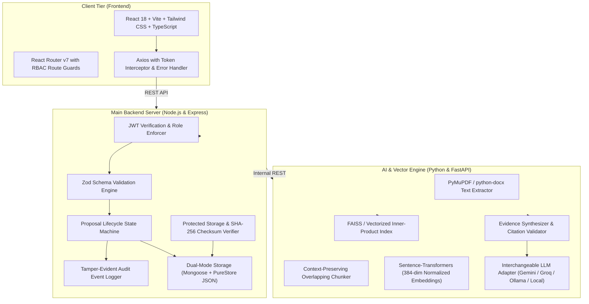

# IPMPRS — Intelligent Proposal Management & Precedent Retrieval System
**Puducherry Police Hackathon 2026**


---

## 1. System Overview

**IPMPRS (Intelligent Proposal Management & Precedent Retrieval System)** is an enterprise, high-assurance web platform engineered for law enforcement proposal governance and historical decision precedent retrieval.

Police administrative, technical, procurement, and infrastructure proposals often require scrutiny against previous sanctions, rejections, observations, and field outcomes. Historical precedents are frequently scattered across non-standardized PDFs, scanned orders, and physical case files. 

IPMPRS solves this by delivering an end-to-end platform featuring:
- **Full Proposal Lifecycle Management**: A strictly validated, tamper-evident finite state machine (Draft → Submitted → Under Review → Clarification Requested → Resubmitted → Approved/Rejected → Implementation → Closed).
- **Zero-Trust Role-Based Access Control (RBAC)**: Backend-enforced permissions across 6 distinct law enforcement roles.
- **Evidence-Grounded Semantic Precedent Search**: Hybrid vector retrieval allowing natural language queries with similarity scores clearly presented as relevance signals.
- **Defense-in-Depth Retrieval-Augmented Generation (RAG)**: Evidence-based precedent analysis with cross-verified document and page citations, crucial differences, budgetary comparisons, and unresolved technical questions.
- **Human-in-the-Loop Decision Sovereignty**: Official sanction decisions remain solely with authorized officers. The AI is strictly advisory and cannot autonomously approve or reject proposals.

---

## 2. System Architecture



---

## 3. Law Enforcement Roles & Permissions

All permissions are strictly verified server-side via middleware. UI elements are tailored to the authenticated officer's authority.

| Role | Primary Responsibilities | Preconfigured Demo Email | Passcode |
| :--- | :--- | :--- | :--- |
| **Department Officer / Proposal Author** | Draft proposals, respond to queries, track implementation | `officer@police.gov.in` | `Police@2026` |
| **Reviewer** | Technical scrutiny, add observations, request clarification | `reviewer@police.gov.in` | `Police@2026` |
| **Approving Authority** | Exercise formal sanction or rejection with legal reasons | `approver@police.gov.in` | `Police@2026` |
| **Knowledge Administrator** | Manage document repository, reprocess vector indices | `knowledge@police.gov.in` | `Police@2026` |
| **System Administrator** | User account management, department configuration, health monitoring | `admin@police.gov.in` | `Police@2026` |
| **Auditor** | Inspect immutable append-only audit trail and workflow events | `auditor@police.gov.in` | `Police@2026` |

---

## 4. Proposal Lifecycle State Machine

```
[Draft] 
   └── (Submit) ──> [Submitted] 
                       └── (Review) ──> [Under Review]
                                           ├── (Query) ──> [Clarification Requested] ──> (Resubmit) ──> [Resubmitted] ──> [Under Review]
                                           ├── (Sanction) ──> [Approved] ──> (Start) ──> [Implementation In Progress] ──> [Implemented] ──> (Archive) ──> [Closed]
                                           └── (Disallow) ──> [Rejected] ──> (Archive) ──> [Closed]
```

Every transition verifies actor authorization, logs a tamper-evident `WorkflowEvent`, and emits an `AuditEvent` with correlation IDs.

---

## 5. Technology Stack

- **Frontend**: React 18, Vite, TypeScript, Tailwind CSS, React Router v7, Axios, Lucide React, Recharts.
- **Backend API**: Node.js v24, Express, Mongoose, JWT, bcryptjs, Zod, Multer, Morgan.
  - *Dual-Mode Persistence*: Supports live MongoDB servers via `MONGODB_URI` and automatic fallback to an in-process, zero-native-binary JSON document store (`PureStore`) for environments running under strict Windows Defender Application Control (WDAC).
- **AI Service**: Python 3.10+, FastAPI, Uvicorn, PyMuPDF (fitz), python-docx, Sentence-Transformers (`all-MiniLM-L6-v2`), FAISS Vector Index, Multi-Provider LLM Adapter (Gemini, Groq, Ollama, Grounded Local Provider).

---

## 6. Local Quickstart & Verification

### Prerequisites
- Node.js v18+ (Node.js v24 installed)
- Python 3.10+ (Thonny or system Python installed)
- Git

### 1. Clone & Setup Workspace
```bash
git clone <repository_url>
cd Police_Helping_Platfortm
```

### 2. Run Automated Verification Tests
Run the complete end-to-end test suite (14 backend integration tests + full AI pipeline tests):
```bash
npm run test
```
*Expected Output:*
```
✔ POST /api/auth/login - Success for Officer Creator
✔ POST /api/auth/login - Success for Approving Authority
✔ POST /api/auth/login - Failure on Invalid Password
✔ GET /api/auth/me - Access profile with valid token
✔ GET /api/users - Non-Admin is Forbidden (403)
✔ 1. Create Draft Proposal as Officer
✔ 2. Attempt Illegal Direct Approval on Draft -> Rejects (400)
✔ 3. Submit Proposal Draft -> Moves to Submitted
✔ 4. Reviewer records observation -> Moves to Under Review
✔ 5. Reviewer requests clarification -> Moves to Clarification Requested
✔ 6. Officer responds and resubmits -> Moves to Under Review with Version 2
✔ 7. Approving Authority sanctions -> Moves to Approved with Decision record
✔ All AI Service tests (Chunker, Embedder, FAISS, Citations, RAG) passed!
```

### 3. Start Runtimes

#### Terminal 1: Main Backend Server (Port 5000)
```bash
npm run dev:backend
```
Backend API will start at `http://127.0.0.1:5000`. Database seeds automatically on initial startup.

#### Terminal 2: AI Service (Port 8000)
```bash
npm run dev:ai
```
FastAPI AI Service will listen on `http://127.0.0.1:8000`.

#### Terminal 3: Frontend Client (Port 5173)
```bash
npm run dev:frontend
```
Open `http://localhost:5173` in any browser.

---

## 7. Fictional Synthetic Scenario & Evaluator Guide

For the Puducherry Police Hackathon 2026, the system includes realistic, clearly labelled fictional test cases centered around a common departmental challenge: **Smart Optical & CCTV Surveillance Systems**:

1. **`PROP-SYN-2023-0101`**: *CCTV Surveillance for Rock Beach Promenade* (Approved: ₹44 Lakhs, 38 cameras deployed, 3-year AMC).
2. **`PROP-SYN-2023-0214`**: *Solar-Powered Wireless CCTV for Rural Checkposts* (Rejected: Battery degradation in coastal humidity, recurring 4G SIM bandwidth expenses).
3. **`PROP-SYN-2024-0042`**: *ANPR & Red-Light Violation Detection* (Approved with modifications: ₹68 Lakhs, integrated with National VAHAN API).
4. **`PROP-SYN-2024-0189`**: *Facial Recognition Camera Pilot in Sunday Market* (Modified: Biometrics withheld pending statutory privacy guidelines).
5. **`PROP-2026-0001`**: *Active Live Proposal Under Review*: *High-Resolution Smart CCTV Network for White Town Heritage Corridor & Promenade Beach* (Awaiting review in the live queue!).

**Judges Quick Login:** Click any of the pre-filled role buttons on the `/login` screen to seamlessly evaluate the system across different authorization levels.

---

## 8. Security & Compliance Disclaimers

1. **Synthetic Data**: All names, sanction order numbers, and budget allocations in demo data are fictional constructs generated solely for hackathon demonstration.
2. **AI Advisory Role**: The AI Precedent Analysis matrix provides evidence extraction and similarity signals. Official sanction authority remains strictly with authorized police officers.
3. **Audit Trails**: All logins, logouts, proposal state changes, document uploads, downloads, and searches are immutably logged with client IP addresses and correlation identifiers.
# IPMPRS
