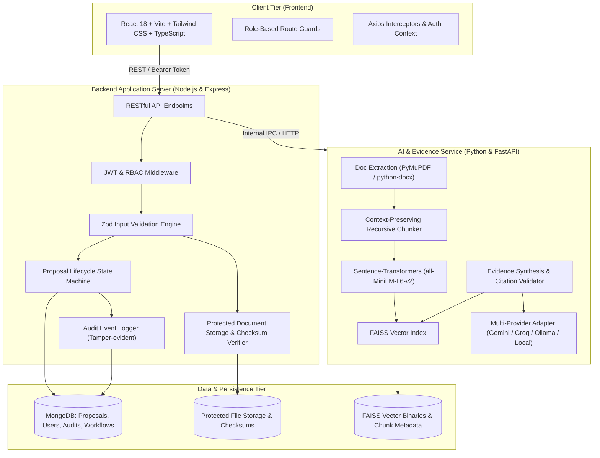
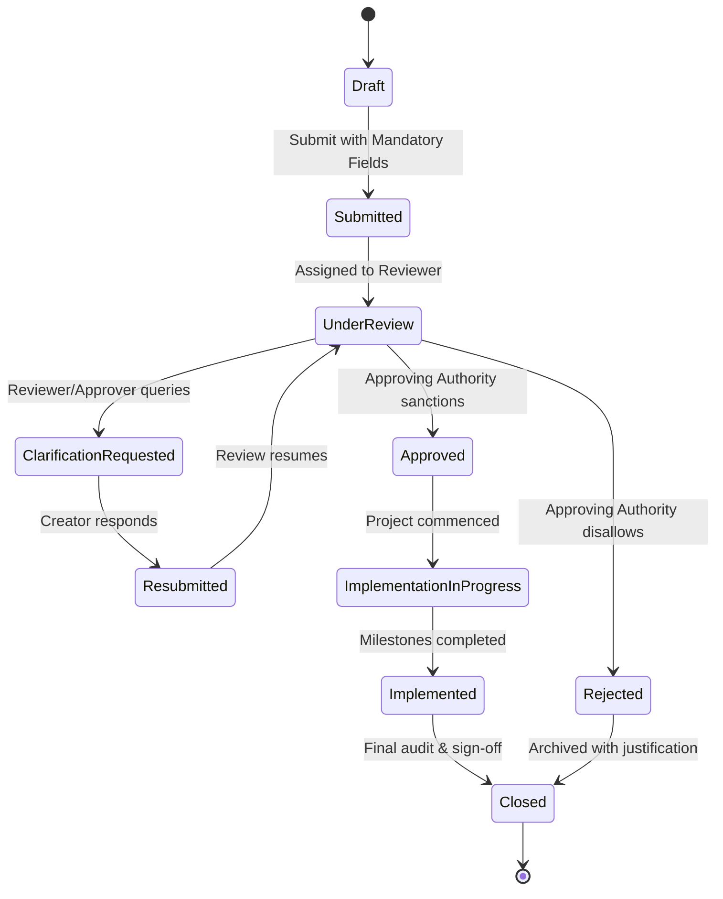

# IPMPRS System Architecture
**Intelligent Proposal Management & Precedent Retrieval System**
*Puducherry Police Hackathon 2026*

## 1. System Overview

IPMPRS is a high-assurance, secure, AI-augmented enterprise platform engineered specifically for law enforcement administrative, technical, procurement, infrastructure, and operational proposal management. The system guarantees that AI serves strictly as an evidential advisory layer—never autonomously granting or denying departmental sanctions.

---

## 2. Core Security & Architectural Principles

1. **Human-in-the-Loop Sovereignty**: The AI provides grounded precedent extraction and comparative similarity matrices; official decisions remain exclusively in the hands of authorized departmental officers.
2. **Defensive RAG with Strict Citation Grounding**: Every precedent claim must map directly to an extracted document chunk with identifiable page numbers and checksums. Unverifiable claims are flagged as "Insufficient Evidence".
3. **Defense-in-Depth RBAC**: Frontend UI masking is supplemented by strict backend route-level, method-level, and resource-level access control with department-boundary isolation.
4. **Immutable Audit Trails**: State transitions, document downloads, extraction pipelines, and AI reports record correlation IDs, actor identifiers, timestamps, IP addresses, and transition rationale.
5. **Decoupled Vector & Document Storage**: Vectors and embeddings are stored inside a high-speed FAISS index; source documents reside in access-restricted storage, while MongoDB maintains operational relational schemas.

---

## 3. Role-Based Access Control (RBAC) Matrix

| Capability / Action | Officer / Creator | Reviewer | Approving Authority | Knowledge Admin | System Admin | Auditor |
| :--- | :---: | :---: | :---: | :---: | :---: | :---: |
| Create & Edit Draft Proposals | Yes | No | No | No | No | No |
| Submit / Resubmit Proposal | Yes | No | No | No | No | No |
| View Department Precedents | Yes | Yes | Yes | Yes | Yes | Yes |
| Record Review Observations | No | Yes | No | No | No | No |
| Request Clarification | No | Yes | Yes | No | No | No |
| Formal Approval / Rejection | No | No | Yes | No | No | No |
| Manage Historical Repository | No | No | No | Yes | Yes | No |
| Reprocess / Re-index Documents| No | No | No | Yes | Yes | No |
| User & System Administration | No | No | No | No | Yes | No |
| Read Full Audit Trails | No | No | Yes | No | Yes | Yes |

---

## 4. Proposal State Machine

